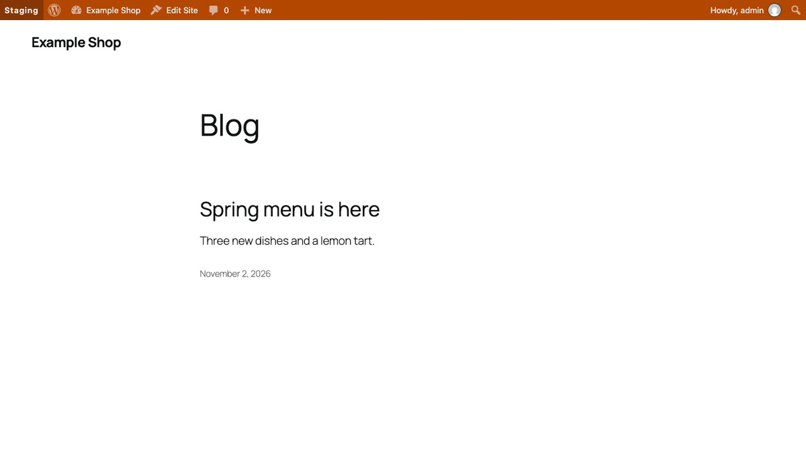
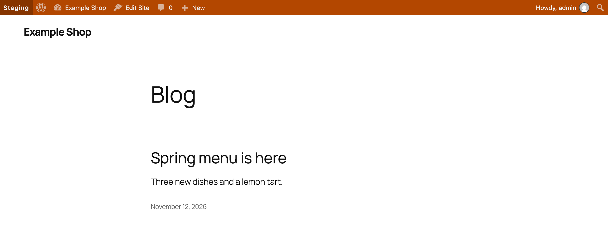
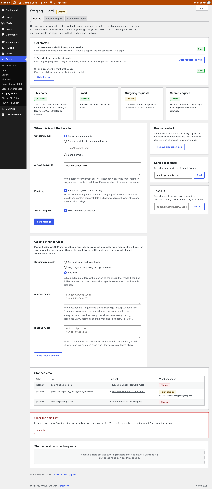
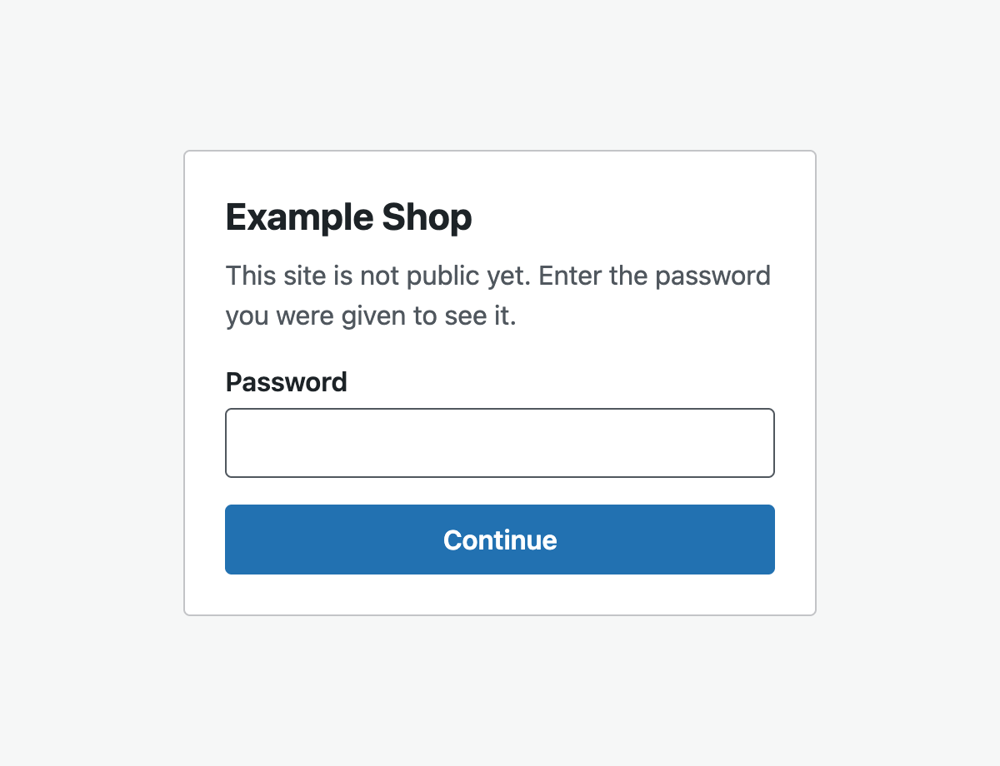
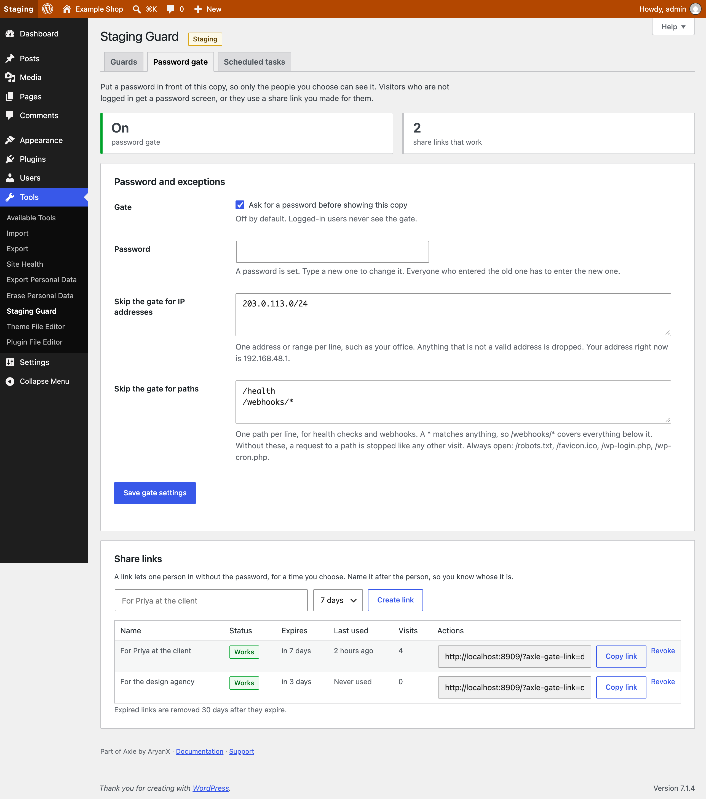
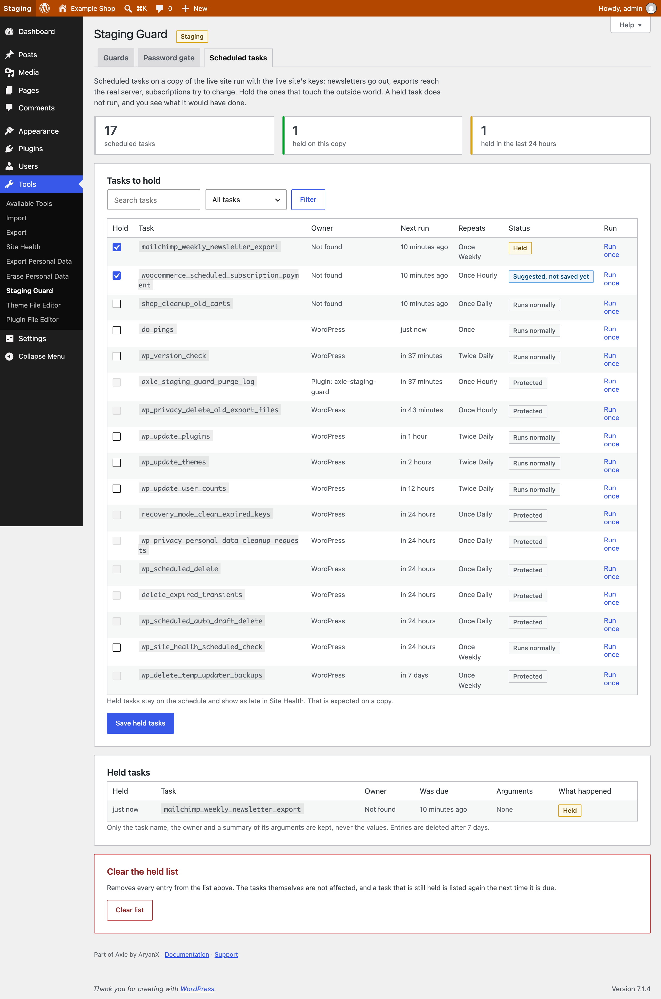

<p align="center"></p>

<h1 align="center">Axle Staging Guard</h1>

<p align="center">
  <a href="https://try.axlewp.com/axle-staging-guard"></a>
  <a href="https://github.com/aryanjasala/axle-staging-guard/releases/latest"></a>
  
  
  <a href="LICENSE.md"></a>
  <br>
  <a href="https://github.com/aryanjasala/axle-staging-guard/actions/workflows/phpcs.yml"></a>
  <a href="https://github.com/aryanjasala/axle-staging-guard/actions/workflows/phpstan.yml"></a>
  <a href="https://github.com/aryanjasala/axle-staging-guard/actions/workflows/unit-tests.yml"></a>
  <a href="https://github.com/aryanjasala/axle-staging-guard/actions/workflows/e2e-tests.yml"></a>
  <a href="https://github.com/aryanjasala/axle-staging-guard/actions/workflows/plugin-check.yml"></a>
</p>

<p align="center">Stop staging copies from emailing real customers or showing up in Google, and color the admin bar so nobody edits the wrong copy.</p>

<p align="center">
  
</p>

---

Every agency has a staging story: a copy of the live database goes to staging and emails every customer, Google indexes it, or someone spends an hour editing it thinking it was live. Axle Staging Guard prevents all three on every copy that is not production, and does nothing on the live site. It can also stop the copy from calling payment gateways, CRMs and webhooks with live keys, put a password in front of the copy so only the people you choose can see it, and hold the scheduled tasks that would reach the real world, such as a weekly newsletter export.

> [!NOTE]
> Free and open source under the GPL. No pro version, no upsells, no ads in wp-admin, no tracking. And it stays that way.
>
> Part of [Axle](https://axlewp.com/) by AryanX, a family of free plugins for running WordPress sites safely.

## Features

- **Email**: blocked, or sent to one test address with the real recipients in the subject. Cc and Bcc stripped
- **Always deliver to**: addresses and whole domains that still get email, so the team can test real flows
- **Email log** of the last 50 stopped emails, with bodies only if you turn that on
- **Outgoing API calls**: block everything except allowed hosts, or log only, for requests made through the WordPress HTTP API. A blocked call fails with a clear error, never a fake success
- **Request list** with method, host, path, the plugin that made the call and how often, with secrets and query strings left out, and a **Test a URL** button
- **Search engines**: `X-Robots-Tag` header, `noindex, nofollow` meta tag, a blocking robots.txt, no sitemap
- **Password gate**: visitors who are not logged in see a small password screen (401, never cached, never indexed). Off by default, never on the live site. Skip it by IP range or path, with a lockout after wrong passwords
- **Share links**: a named, timed link (1 to 30 days) that lets one person in without the password. The list shows when each was last used, and a revoked link ends access on the next page view
- **Scheduled tasks**: see every WP-Cron task with its owner and next run, tick the ones to hold on staging, and run one by hand. Held tasks are listed, never silently dropped
- **Admin bar** colored by environment, and `[Staging]` at the start of every browser tab title
- **Production lock**: mark the live site once, and every database copy on another domain counts as staging
- **Site Health** checks that warn when email could still reach real people, when a staging copy is open to anyone, and when risky tasks still run

## Install

1. Download `axle-staging-guard.zip` from the [latest release](https://github.com/aryanjasala/axle-staging-guard/releases/latest).
2. In WordPress, go to **Plugins > Add New Plugin > Upload Plugin**, choose the zip and activate it.

Or with WP-CLI:

```sh
wp plugin install https://github.com/aryanjasala/axle-staging-guard/releases/latest/download/axle-staging-guard.zip --activate
```

Needs WordPress 6.6+ and PHP 7.4+. To try it first, [try.axlewp.com/axle-staging-guard](https://try.axlewp.com/axle-staging-guard) opens a private WordPress in your browser with the latest release and some demo content. Nothing to install.

## Quick look

Pin the email behavior per environment in wp-config.php, so a database copy cannot change it:

```php
define( 'AXLE_STAGING_GUARD_MAIL_MODE', 'redirect' );   // block, redirect or allow
define( 'AXLE_STAGING_GUARD_REDIRECT_TO', 'qa@example.com' );
define( 'AXLE_STAGING_GUARD_ALLOWLIST', '@youragency.com' );
define( 'AXLE_STAGING_GUARD_HTTP_MODE', 'block' );      // allow, log or block
define( 'AXLE_STAGING_GUARD_HTTP_ALLOWED_HOSTS', 'sandbox.paypal.com, *.youragency.com' );
```

It decides a copy is not live from `WP_ENVIRONMENT_TYPE` when that is set, otherwise from the **production lock**: a hash of the live domain, which survives the search-replace step of a migration.

## Screenshots

<table>
  <tr>
    <td width="50%" valign="top"><br><sub>The coloured admin bar on a staging copy</sub></td>
    <td width="50%" valign="top"> Staging Guard with the email log"><br><sub>Tools > Staging Guard with the email log</sub></td>
  </tr>
  <tr>
    <td width="50%" valign="top"><br><sub>The password gate screen visitors see</sub></td>
    <td width="50%" valign="top"><br><sub>Share links, each named and timed, with when it was last used</sub></td>
  </tr>
  <tr>
    <td width="50%" valign="top"><br><sub>Scheduled tasks, with the ones to hold on staging</sub></td>
  </tr>
</table>

## Documentation

| Doc | What it covers |
| --- | --- |
| [Reference](docs/REFERENCE.md) | Environment detection, constants, hooks, the password gate, scheduled tasks, abilities and WP-CLI |
| [Development](docs/DEVELOPMENT.md) | Local setup, commands and tests |
| [Contributing](docs/CONTRIBUTING.md) | Pull requests, required checks and PR titles |
| [Releasing](docs/RELEASING.md) | How merged pull requests become releases |
| [Security](docs/SECURITY.md) | Reporting a vulnerability |
| [readme.txt](readme.txt) | What WordPress.org shows, with the FAQ and changelog |

## Project structure

```
axle-staging-guard.php          plugin header and PSR-4 autoloader
src/
├── Plugin.php             creates the services, guards load only when not production
├── Settings.php           the settings option and allowlist parsing
├── Environment.php        environment detection and the production lock
├── Mail/
│   ├── Guard.php          who an email may reach
│   └── Log.php            the stopped email list
├── Http/
│   ├── Rules.php          host patterns and the decision, no WordPress state
│   ├── Guard.php          pre_http_request, policy and caller detection
│   └── Log.php            the request list
├── Gate/
│   ├── Access.php         tokens, IP ranges and path patterns, no WordPress state
│   ├── Gate.php           the password gate: who passes, lockout, cookies
│   ├── Links.php          share links, and their privacy tools
│   └── Screen.php         the password screen
├── Cron/
│   ├── Tasks.php          the schedule, owners, suggestions, protected hooks
│   ├── Hold.php           holds tasks, runs one once
│   └── Log.php            the held list
├── Search/Robots.php      noindex header and tag, robots.txt, sitemaps
├── Admin/                 settings screen and its tabs, admin bar and tab titles
├── Health/SiteHealth.php  the Site Health checks
└── Cli/                   wp axle-staging-guard, gate, gate link and hold
tests/
├── Unit/                  PHPUnit
└── e2e/                   Playwright specs and the Docker site
.wordpress-org/            screenshots
docs/                      reference, development, contributing, releasing
```

## More free plugins

Small plugins that each fill one gap in WordPress, all free with no pro version. Try them all together at [demo.axlewp.com](https://demo.axlewp.com/).

| | Plugin | What it does |
| --- | --- | --- |
|  | [Axle Page Template Usage](https://github.com/aryanjasala/axle-page-template-usage) | See which template every page uses, and fix the pages on a missing template |
|  | [Axle Category & Tag Trash](https://github.com/aryanjasala/axle-category-tag-trash) | A trash for categories, tags and custom terms, with undo and full restore |
|  | [Axle Read-Only Mode](https://github.com/aryanjasala/axle-read-only-mode) | Read-only mode for WordPress during migrations and deploys |
|  | [Axle Block Restore](https://github.com/aryanjasala/axle-block-restore) | Restore a single block from an old revision, not the whole post |
|  | [Activity Log with Undo](https://github.com/aryanjasala/activity-log-with-undo) | An activity log where every change you can reverse has an Undo button |
|  | [Agent Governance](https://github.com/aryanjasala/agent-governance) | Hold risky AI agent calls for approval, preview what they change, and roll back a session |
|  | [Axle AI Guard](https://github.com/aryanjasala/axle-ai-guard) | See and control every AI call your plugins make: cost, data sent, budgets and a kill switch |
|  | [Axle Config Sync](https://github.com/aryanjasala/axle-config-sync) | Keep settings in git, diff them against the live site, apply with a preview and undo |
|  | [Axle Leftovers](https://github.com/aryanjasala/axle-leftovers) | Find what deleted plugins and themes left behind, see who owns it and why, and clean it up with undo |
|  | [Axle License Tracker](https://github.com/aryanjasala/axle-license-tracker) | See which premium plugins are licensed, which lapsed and stopped getting updates, and what renews when |
|  | [Axle Review](https://github.com/aryanjasala/axle-review) | Share drafts through private links, collect outside feedback as block Notes, and know when an approval is out of date |
|  | [Axle Runtime Doctor](https://github.com/aryanjasala/axle-runtime-doctor) | Check OPcache coverage, the object cache, PHP support and limits, cron and more, with the fix for your host |
|  | [Axle Smoke Test](https://github.com/aryanjasala/axle-smoke-test) | Check key pages after every update or deploy, see what broke and roll it back |
|  | [Block Doctor](https://github.com/aryanjasala/block-doctor) | Scan the site for broken blocks and fix them in bulk, with undo. See which posts use each block before you switch a plugin off |
|  | [Block Theme Ops](https://github.com/aryanjasala/block-theme-ops) | Find Site Editor changes that override your theme files, see the diff, reset them or send them to Git |
|  | [Role Right-Sizer](https://github.com/aryanjasala/role-right-sizer) | Recommends the smallest role each user needs, from what they actually do |
|  | [Update Rehearsal](https://github.com/aryanjasala/update-rehearsal) | Try plugin, theme, core and PHP updates on a disposable copy of your site in WordPress Playground first |
|  | [User Session Manager](https://github.com/aryanjasala/user-session-manager) | See every device signed in, sign out one, and limit sessions per role |

## License

Copyright Aryan Jasala. Licensed under [GPL-2.0-or-later](LICENSE.md).
